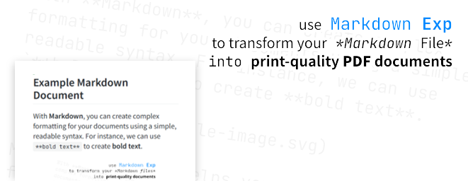
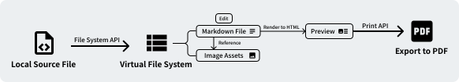
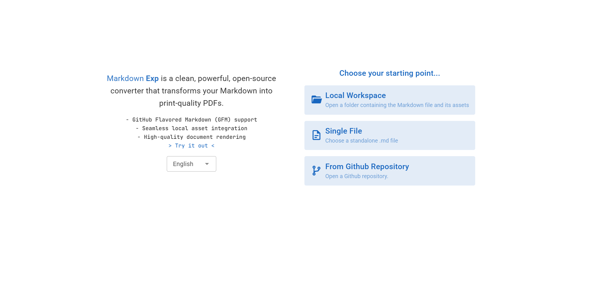
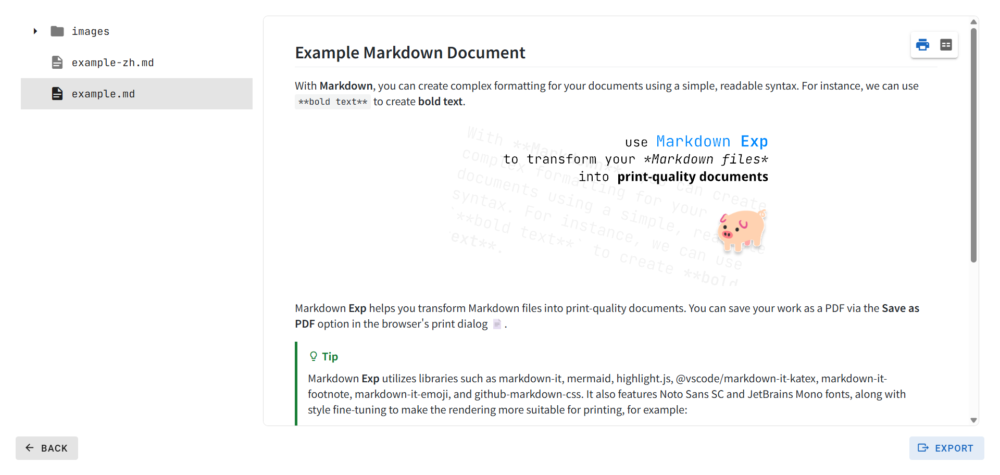
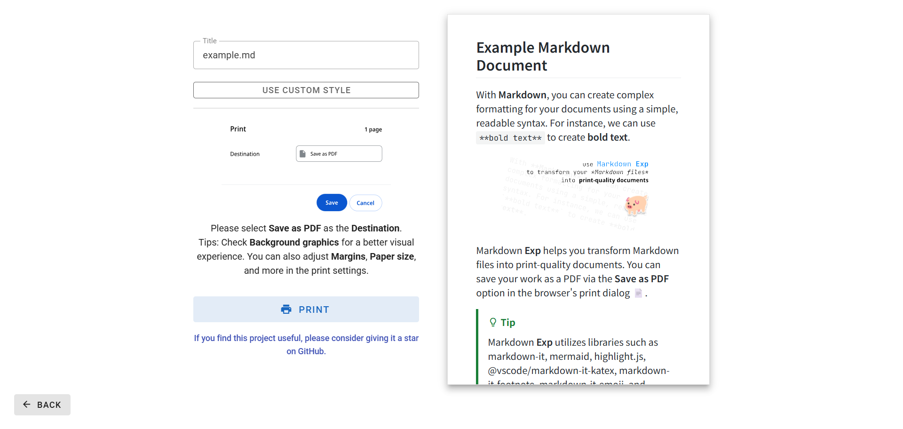

<a href="https://waterblock79.github.io/markdown-exp" about="_blank"><h2 align="center">Markdown Exp</h2></a>

<a href="https://waterblock79.github.io/markdown-exp"></a>


<p align=center>
Markdown <b>Exp</b> is a clean, powerful open-source Markdown to PDF online converter.<br /> We also provide a skill that lets agents convert Markdown files to HTML / PDF.<br />
> <a href="https://waterblock79.github.io/markdown-exp"><b> Try it Online</b></a> | <a href="https://github.com/waterblock79/markdown-exp/blob/main/.agents/skills/"><b>View the skill</b></a> <
</p>

---

此文档亦有 [中文](https://github.com/waterblock79/markdown-exp/blob/main/docs/README-zh.md) 版本。

### Features

- 📄 Full **GitHub Flavored Markdown** (GFM) support
- 📝 Load files from **local** / **remote repositories**
- 📁 Seamlessly **integrate local assets** (referenced local images, etc.)
- 🪶 **Edit** and **preview** Markdown files online
- 🖨️ **Print-quality** Markdown rendering



### Skill

Agents can use the Markdown Exp skill to turn Markdown files into HTML or PDF documents, it is suitable for scenarios such as generating highly readable, visually appealing documents when an Agent outputs result documents. Paste this prompt into your agent:

```text
Clone https://github.com/waterblock79/markdown-exp and install the skill from
`.agents/skills/markdown-exp/` into your skills directory, for example
`~/.agents/skills/markdown-exp/` (or `.agents/skills/markdown-exp/` in the
current project). Keep `SKILL.md` and `scripts/` together, read `SKILL.md`,
and follow it whenever you need to convert Markdown to HTML or PDF.
```

Full instructions: `.agents/skills/markdown-exp/SKILL.md`.  
Pairs well with `humanizer` and similar skills for more human-sounding, higher-quality documents.

### Screenshots







### Development

```bash
# Requires Node.js and pnpm
pnpm install
pnpm dev
pnpm build
```

Markdown rendering workflow of this project is detailed in `docs/markdown-rendering.md`.